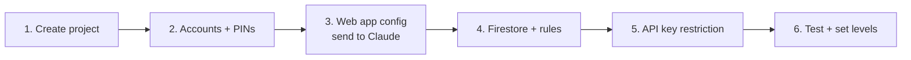

# Firebase setup for KidsChinese

KidsChinese has its own Firebase project, separate from Kids Games and Reads.
A sign-in on one site does not affect the other sites.
Do these steps one time. They take about 20 minutes.

Until step 3 is done, the site shows "Not set up yet".

## 1. Create the project

1. Open https://console.firebase.google.com and click **Create a project**.
2. Name: `kidschinese` (Firebase adds a suffix to the project ID, for example `kidschinese-1a2b3`).
3. Google Analytics: **off**. It is not necessary.

## 2. Make the four accounts

1. Select **Build → Authentication → Get started**.
2. In **Sign-in method**, turn on **Email/Password**. Leave "Email link" off.
3. In **Users**, click **Add user** four times:

   | Email | Who | Role |
   |---|---|---|
   | `yc@kidschinese.invalid` | YC | learner |
   | `jy@kidschinese.invalid` | JY | learner |
   | `sl@kidschinese.invalid` | SL | parent |
   | `cj@kidschinese.invalid` | CJ | parent |

   The password is that person's **6-digit PIN**. Do not write the PINs in this repo or in a chat.
4. In **Settings → User actions**, turn off **Enable create (sign-up)** and **Enable delete**.
   Then nobody can add or delete an account from the browser.

The emails end in `.invalid` on purpose: no email is ever sent. To change a PIN later, use
`admin/reset-pin.mjs` (see [admin/README.md](../admin/README.md)).

## 3. Register the web app and send the config

1. Select **Project settings** (⚙) → **General** → **Your apps** → the web icon `</>`.
2. Nickname: `kidschinese-web`. Do not turn on Firebase Hosting (GitHub Pages hosts the site).
3. Copy the `firebaseConfig` object (apiKey, authDomain, projectId, …).
4. Send it to Claude, or paste it into `js/firebase/config.js` in place of `null`.

This config is not a secret. It only names the project. The Firestore rules control access.

## 4. Create Firestore and publish the rules

1. Select **Build → Firestore Database → Create database**.
2. Database ID `(default)`. Location: `us-west1` (Oregon), the same as Reads. You cannot change it later.
3. Start in **production mode**.
4. Open the **Rules** tab. Replace all of the text with the whole file
   [`firebase/firestore.rules`](firestore.rules). Click **Publish**.

What the rules allow:

| | YC / JY (learner) | SL / CJ (parent) |
|---|---|---|
| Read own progress | ✓ | — |
| Read the other learner's progress | ✗ | ✓ (both) |
| Save answers, stars, streak | own only | ✗ |
| Change own settings (Pinyin, English, animal) | ✓ | ✓ (for a learner) |
| Set a learner's level | ✗ | ✓ |
| Reset a learner's progress | ✗ | ✓ |

Every other read or write is refused, also for any other account.

## 5. Restrict the API key to the site

1. Open https://console.cloud.google.com, select the `kidschinese` project.
2. Select **APIs & Services → Credentials → Browser key (auto created by Firebase)**.
3. In **Application restrictions**, select **Websites**. Add:
   - `https://seanlin-larc.github.io/*`
   - `http://localhost:8000/*`
4. Click **Save**. It can take a few minutes to apply.

This is the same restriction as Kids Games and Reads.

## 6. Test and set the levels

1. Open https://seanlin-larc.github.io/KidsChinese/ and sign in as **SL**.
2. The parent page shows YC and JY. Set each child's **Level** (程度).
   Suggested: JY 初級 Beginner, YC 中級 Intermediate.
3. Sign out. Sign in as **YC**, do one round, and check that the stars stay after a reload.
4. Sign in as **SL** again. YC's card now shows the round.

## Notes

- **Offline:** after the first sign-in on a device, the app works without internet. Answers are
  kept on the device and sent when the device is online again.
- **Progress from before accounts** (saved only in the browser) is not moved to Firebase.
- **Costs:** two kids use far less than the Firestore free tier (50,000 reads and 20,000 writes
  each day). See https://firebase.google.com/pricing.
